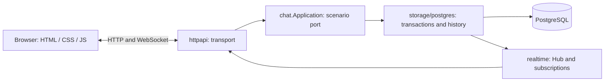
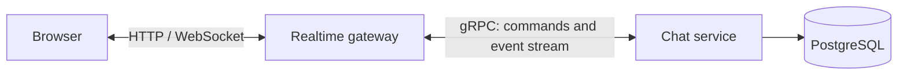

# nullchat architecture

## Decision 001: a custom Go service instead of Matrix

Ephemeral rooms need neither federation nor compatibility with Matrix clients. A custom implementation makes concurrency, delivery and lifecycle the centerpiece of the portfolio. The cost of this decision is that these rules and their correctness now have to be implemented and verified by the project itself.

## Decision 002: a single process first

`cmd/server` wires the dependencies: it loads the configuration, opens a `pgxpool` with `DB_MAX_CONNS`, checks the connection within `DB_OPERATION_TIMEOUT` and creates the PostgreSQL service. Migrations are run explicitly via `cmd/migrate`; the API process never applies them automatically. `chat` does not import transport libraries; `httpapi.Chat` is the local name of the `chat.Application` port.

`chat` contains the application types, errors and the `Application` port; the active adapter is `internal/storage/postgres`. `internal/storage/memory` remains an auxiliary adapter for tests. HTTP/WebSocket depend only on the port and know nothing about SQL or `pgxpool`. The PostgreSQL scenarios own transactional atomicity: an interface made of `GetRoom`/`SaveRoom` must not make it possible to accidentally split the limit check from taking the seat.

Transactions serialize changes with a lock on the room row. Subscribe holds a share lock while reading the snapshot and registering the subscription; writes take an update lock. A short service mutex coordinates commit/publication and snapshot registration, so there is no gap between the snapshot and the live stream in a running process. `internal/realtime` owns the bounded queues, the per-session subscription limit and closing subscribers; network I/O is not performed under the application mutex. A single service instance is supported; this is not a claim of horizontal scaling.

Each connection has a reader loop and an event loop with heartbeat. The `coder/websocket` library in use allows concurrent writes, so acks and broadcasts can be reordered; the application-level `sequence` defines message order. A client leaving cancels the context and ends the reader; upgraded connections are closed separately on shutdown.

## Decision 003: application boundaries and realtime

The transport depends on `chat.Application`, a small scenario port with `context.Context`: create, join, subscribe, send, end and ready. The port describes atomic operations, not `GetRoom`/`SaveRoom` primitives that could split the access check from the state change. `/healthz` checks only process liveness and does not touch the DB; `/readyz` calls `Ready`, which pings the pool. On a DB failure, readiness and application operations return a stable `database_unavailable` without driver error text.

Subscriptions and backpressure are extracted into `internal/realtime`. The Hub receives only stable room/session keys and events, so it knows nothing about HTTP, WebSocket or the storage structure. Delivery through the Hub is best-effort after commit; there is no transactional outbox or durable replay yet. A failure between commit and broadcast is compensated by a full snapshot of the acknowledged history on reconnect.

## Decision 004: lifecycle and recovery

Rooms, participants, sessions, invites and acknowledged messages are stored in PostgreSQL and survive a backend restart. Graceful shutdown stops HTTP/WebSocket and the expiry worker, then calls `Service.Close` only to release Hub subscriptions, and closes the pool. Shutdown is purely an infrastructure stop: it does not call `End`, does not change the room status and does not revoke credentials. Before WebSocket close `1001` the server sends a JSON `server_shutdown` event; the browser keeps the session and schedules a reconnect via `onclose`.

`End` on an explicit participant action and `Expire` on TTL perform a permanent logical close in a transaction: they change the room status, revoke the sessions and the invite, and after commit publish `room_closed` or `room_expired`. In the same worker cycle, a separate atomic `DELETE` removes `idempotency_requests` rows whose `expires_at` has passed; keeping it apart from the room-lock transactions preserves a single lock order with replay. Before deletion replay is unavailable; after deletion the key is treated as new again. Expiry runs at startup and every `EXPIRY_INTERVAL`, with a `DB_OPERATION_TIMEOUT` deadline; a failure is retried on the next tick. Each protected scenario checks the access expiry independently, so a stopped worker does not extend the TTL.

TTL starts at creation and is not extended by activity. Closing the tab does not free the seat. Any participant can end the conversation. These rules do not depend on whether a WebSocket is currently connected. The display name is generated randomly by the backend from an English set and is unique within a room; application scenarios do not depend on fixed names.

On the client side, the states `connecting`, `connected`, `reconnecting`, `expired`, `closed` and `unavailable` distinguish a temporary transport loss, finally revoked access and backend/DB unavailability. Temporary states do not delete the saved session. A send error keeps the message for a retry with the same `client_message_id`.

Resource errors are also split by cause: full room, message limit, connection limit, request rate and unavailable DB have different stable codes. This is part of the external contract, not just log text.

## Decision 005: PostgreSQL and the limits of the guarantees

Entities: `rooms`, `participants`, `sessions`, `invites`, `messages`, `idempotency_requests`. Tokens are stored as SHA-256 hashes. Uniqueness of `(room_id, participant_id, client_message_id)` provides deduplication. Join atomically uses the invite and registers the guest; send checks the TTL, allocates a sequence and writes the message.

An ack after commit means acceptance by PostgreSQL within its durability settings. It is not a confirmation of delivery to the contact or of reading. Currently a reconnect gets a full snapshot from the DB through a new pool/service; a history cursor, pagination and a transactional outbox need a separate design.

Create/join idempotency via `Idempotency-Key` returns the same result after a lost HTTP response, including credentials, within a limited window and after checking the fingerprint of the original request. The response is stored encrypted with AES-GCM using the deployment key; plaintext tokens and the key do not end up in logs.

Target retention limits for version 0.2: room data and events — up to the TTL plus 24 hours for cleanup; an idempotency record — until the room ends and at most 24 hours after the request. Retention in the primary DB does not mean immediate deletion from WAL and backups; that is described separately.

Logical closing on TTL and physical deletion of expired idempotency envelopes are implemented and repeatable. Physical cleanup of the remaining room rows, history and the WAL/backup policy remain a separate task; the expiry worker does not promise deletion of the whole room after 24 hours.

## Decision 006: end-to-end encryption in the browser

Added on direct request, outside the sequence of plan steps. The detailed protocol is in the [design](superpowers/specs/2026-11-06-e2ee-design.md).

Options considered:

- **Key in the link fragment** (like PrivateBin, Excalidraw). Simple, but the link is the key: a leaked link together with the server's data reveals the whole history; there is no forward secrecy.
- **PAKE over a short password** (SPAKE2/CPace, like magic-wormhole). Makes it possible to get by with a password alone, but WebCrypto does not provide the required curve arithmetic — an external JS library would be needed, and the project has no frontend dependencies.
- **Chosen:** ephemeral ECDH P-256, whose shares are signed with an HMAC key derived from the link secret and an optional password (PBKDF2). The server cannot substitute keys, a link leaked after the conversation does not reveal messages, and the password protects against an intercepted link. Everything runs on built-in WebCrypto.

Consequences for the server: `chat` checks only the shape of the opaque fields (`envelope.go`), deduplication compares ciphertexts, and a participant gains `role` and `key_share`. The password is verified without disclosure: the server stores a SHA-256 of a verifier that embeds the link secret, so it has nothing to brute-force the password against; a wrong proof does not consume the invite, and the fifth failure revokes it. Writing before the guest joins is not possible: there is no shared key yet.

Client protection: CSP with Trusted Types and no policies, non-extractable keys in IndexedDB instead of `sessionStorage`, isolation headers, a manifest of frontend hashes (`cmd/webhash`). The fundamental limitation of web E2EE remains: the encryption code is served by the same server. The manifest makes it possible to detect tampering, but not to prevent it.

## Possible two services later

The learning option is to extract connection management:

- **Realtime gateway:** connections, Origin, heartbeat, transport resource limits, delivery to the browser.
- **Chat service:** access, rooms, invites, TTL, messages and sole ownership of the DB.

The first experiment can use unary gRPC commands and server-streaming events without adding a broker at the same time. This is a hypothesis for a future stage, not a committed stack decision. It needs contracts, deadlines, command retries with the same IDs, cursor-based stream recovery and behavior when the core is unavailable.

Simply moving the HTTP handlers into another process will not solve scaling. Multiple core instances will require shared event delivery/room ownership. NATS or another broker should be chosen only after the guarantees are pinned down; an outbox is needed if we promise reliable publication of events from DB transactions.

Criterion for starting: there is a working monolith with PostgreSQL, integration tests and measurements; it can be explained which problem independent connection scaling solves or which distributed semantics we are studying. For the portfolio, the measured effect and the new failure modes should be shown.
