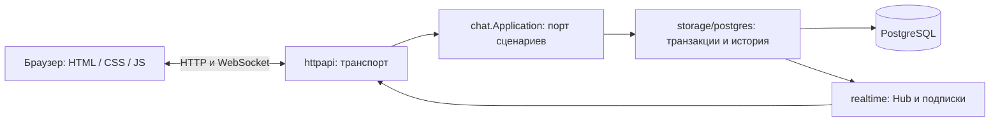
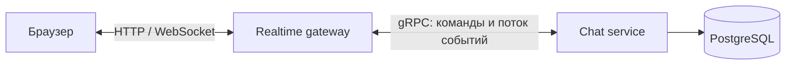

# Архитектура nullchat

## Решение 001: собственный Go-сервис вместо Matrix

Для временных комнат не нужны федерация и совместимость с Matrix-клиентами. Собственная реализация делает конкурентность, доставку и жизненный цикл центральной частью портфолио. Цена решения — эти правила и их корректность теперь нужно реализовывать и проверять самостоятельно.

## Решение 002: сначала один процесс

`cmd/server` собирает зависимости: загружает конфигурацию, открывает `pgxpool` с `DB_MAX_CONNS`, проверяет соединение в пределах `DB_OPERATION_TIMEOUT` и создаёт PostgreSQL-сервис. Миграции запускаются явно через `cmd/migrate`; API-процесс никогда не применяет их автоматически. `chat` не импортирует транспортные библиотеки; `httpapi.Chat` — локальное имя порта `chat.Application`.

`chat` содержит прикладные типы, ошибки и порт `Application`; активный адаптер — `internal/storage/postgres`. `internal/storage/memory` остаётся вспомогательным адаптером для тестов. HTTP/WebSocket зависят только от порта и не знают SQL или `pgxpool`. Сценарии PostgreSQL владеют транзакционной атомарностью: интерфейс из `GetRoom`/`SaveRoom` не должен позволять случайно разнести проверку лимита и занятие места.

Транзакции сериализуют изменения блокировкой строки комнаты. Subscribe удерживает share-lock при чтении снимка и регистрации подписки; записи берут update-lock. Короткий mutex сервиса координирует commit/публикацию и регистрацию snapshot, поэтому между snapshot и live-потоком нет разрыва в работающем процессе. `internal/realtime` владеет ограниченными очередями, лимитом подписок на сессию и закрытием подписчиков; сетевой I/O не выполняется под mutex приложения. Поддерживается один экземпляр сервиса; это не заявка на горизонтальное масштабирование.

Каждое соединение имеет цикл чтения и цикл событий с heartbeat. Используемая библиотека `coder/websocket` допускает конкурентные записи, поэтому ack и broadcast могут менять порядок; прикладной `sequence` задаёт порядок сообщений. Уход клиента отменяет контекст и завершает reader; upgraded-соединения отдельно закрываются при shutdown.

## Решение 003: прикладные границы и realtime

Транспорт зависит от `chat.Application` — небольшого порта сценариев с `context.Context`: create, join, subscribe, send, end и ready. Порт описывает атомарные операции, а не примитивы `GetRoom`/`SaveRoom`, которые могли бы разнести проверку доступа и изменение состояния. `/healthz` проверяет только liveness процесса и не обращается к БД; `/readyz` вызывает `Ready`, который пингует пул. При сбое БД readiness и прикладные операции возвращают стабильный `database_unavailable` без текста ошибок драйвера.

Подписки и backpressure выделены в `internal/realtime`. Hub получает только стабильные ключи комнаты/сессии и события, поэтому не знает о HTTP, WebSocket или структуре хранения. Доставка через Hub — best-effort после commit; transactional outbox и durable replay пока отсутствуют. Сбой между commit и broadcast компенсируется полным снимком подтверждённой истории при reconnect.

## Решение 004: жизненный цикл и восстановление

Комнаты, участники, сессии, приглашения и подтверждённые сообщения хранятся в PostgreSQL и переживают рестарт backend. Graceful shutdown останавливает HTTP/WebSocket и expiry worker, затем вызывает `Service.Close` только для освобождения подписок Hub и закрывает пул. Shutdown — исключительно остановка инфраструктуры: он не вызывает `End`, не меняет статус комнаты и не отзывает credentials. Перед WebSocket close `1001` сервер отправляет JSON-событие `server_shutdown`; браузер сохраняет сессию и планирует reconnect через `onclose`.

`End` по явному действию участника и `Expire` по TTL выполняют постоянное логическое закрытие в транзакции: меняют статус комнаты, отзывают сессии и приглашение, а после commit публикуют `room_closed` или `room_expired`. В том же цикле worker отдельный атомарный `DELETE` удаляет строки `idempotency_requests`, чей `expires_at` уже наступил; отделение от room-lock транзакций сохраняет единый порядок блокировок с replay. До удаления replay недоступен, после удаления ключ снова считается новым. Expiry выполняется при старте и каждые `EXPIRY_INTERVAL`, с deadline `DB_OPERATION_TIMEOUT`; сбой повторяется на следующем тике. Каждый защищённый сценарий независимо проверяет срок доступа, поэтому остановленный worker не продлевает TTL.

TTL начинается при создании и не продлевается активностью. Закрытие вкладки не освобождает место. Любой участник может завершить разговор. Эти правила не зависят от того, подключён ли в данный момент WebSocket. Display name генерируется backend случайно из английского набора и уникален внутри комнаты; прикладные сценарии не зависят от фиксированных имён.

На уровне клиента состояния `connecting`, `connected`, `reconnecting`, `expired`, `closed` и `unavailable` различают временную потерю транспорта, окончательно отозванный доступ и недоступность backend/БД. Временные состояния не удаляют сохранённую сессию. Ошибка отправки оставляет сообщение для повтора с прежним `client_message_id`.

Ошибки ресурсов также разделены по причине: заполненная комната, лимит сообщений, лимит соединений, частота запросов и недоступная БД имеют разные стабильные коды. Это часть внешнего контракта, а не только текст логов.

## Решение 005: PostgreSQL и границы гарантий

Сущности: `rooms`, `participants`, `sessions`, `invites`, `messages`, `idempotency_requests`. Токены хранятся как SHA-256 хеши. Уникальность `(room_id, participant_id, client_message_id)` обеспечивает дедупликацию. Вход атомарно использует приглашение и регистрирует гостя; отправка проверяет TTL, выделяет sequence и записывает сообщение.

Ack после commit означает принятие в PostgreSQL в пределах его настроек durability. Это не подтверждение доставки собеседнику или прочтения. Сейчас reconnect получает полный snapshot из БД через новый пул/сервис; history cursor, pagination и transactional outbox требуют отдельного дизайна.

Идемпотентность create/join по `Idempotency-Key` возвращает тот же результат после потери HTTP-ответа, включая credentials, в ограниченном окне и после проверки отпечатка исходного запроса. Ответ хранится зашифрованным AES-GCM с ключом deployment; открытые токены и ключ не попадают в логи.

Целевые лимиты хранения версии 0.2: данные комнаты и события — до TTL плюс 24 часа на очистку; запись идемпотентности — до конца комнаты и максимум 24 часа после запроса. Retention основной БД не означает немедленное удаление из WAL и резервных копий — это описывается отдельно.

Логическое закрытие по TTL и физическое удаление истёкших idempotency envelopes реализованы и повторяемы. Физическая очистка остальных строк комнаты, история и политика WAL/резервных копий остаются отдельной задачей; expiry worker не обещает удаления всей комнаты через 24 часа.

## Возможные два сервиса позже

Учебный вариант — выделить управление соединениями:

- **Realtime gateway:** соединения, Origin, heartbeat, лимиты транспортных ресурсов, доставка в браузер.
- **Chat service:** доступ, комнаты, приглашения, TTL, сообщения и единственное владение БД.

Первый эксперимент можно провести через unary gRPC-команды и server-streaming событий, не добавляя брокер одновременно. Это гипотеза для будущего этапа, не принятое обязательство по стеку. Нужны контракты, deadlines, повтор команд с прежними ID, восстановление потока с cursor и поведение при недоступном core.

Простое выделение HTTP-обработчиков в другой процесс не решит масштабирование. Несколько core-экземпляров потребуют общей доставки событий/владения комнатами. NATS или другой брокер стоит выбирать только после фиксации гарантий; outbox нужен, если обещаем надёжную публикацию событий из транзакций БД.

Критерий начала: есть работающий монолит с PostgreSQL, интеграционные тесты и измерения; можно объяснить, какую задачу решает независимое масштабирование соединений или какую распределённую семантику изучаем. Для портфолио следует показать измеренный эффект и новые режимы отказа.
