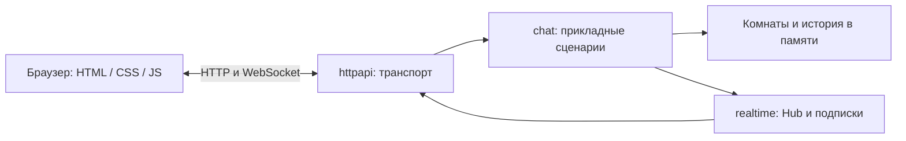
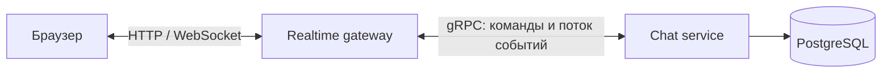

# Архитектура nullchat

## Решение 001: собственный Go-сервис вместо Matrix

Для временных комнат не нужны федерация и совместимость с Matrix-клиентами. Собственная реализация делает конкурентность, доставку и жизненный цикл центральной частью портфолио. Цена решения — эти правила и их корректность теперь нужно реализовывать и проверять самостоятельно.

## Решение 002: сначала один процесс

`cmd/server` собирает зависимости. `chat` не импортирует транспортные библиотеки; `httpapi.Chat` — интерфейс, объявленный потребителем. Отдельных `domain/application/adapters` папок пока нет: их наличие само по себе ничего не гарантирует.

В демо приложение и хранение находятся в одной реализации. Это сознательный промежуточный этап, не готовая гексагональная архитектура с заменяемой persistence. При добавлении PostgreSQL нужно выделить семантические операции хранилища и перенести в него транзакционную атомарность. Интерфейс из `GetRoom`/`SaveRoom` не должен позволять случайно разнести проверку лимита и занятие места.

Для демо один mutex сериализует изменение состояния. Снимок и регистрация подписки выполняются под этой же блокировкой, поэтому сообщение не попадает в разрыв между snapshot и live-потоком. `internal/realtime` владеет ограниченными очередями, лимитом подписок на сессию и закрытием подписчиков; сетевой I/O по-прежнему не выполняется под mutex приложения. Лимит 100 комнат делает стоимость обхода для TTL явной и ограниченной. Это не заявка на большое горизонтальное масштабирование.

Каждое соединение имеет цикл чтения и цикл событий с heartbeat. Используемая библиотека `coder/websocket` допускает конкурентные записи, поэтому ack и broadcast могут менять порядок; прикладной `sequence` задаёт порядок сообщений. Уход клиента отменяет контекст и завершает reader; upgraded-соединения отдельно закрываются при shutdown.

## Решение 003: прикладные границы и realtime

Транспорт зависит от `chat.Application` — небольшого порта сценариев с `context.Context`: create, join, subscribe, send и end. Порт описывает атомарные операции, а не примитивы `GetRoom`/`SaveRoom`, которые могли бы разнести проверку доступа и изменение состояния.

Подписки и backpressure выделены в `internal/realtime`. Hub получает только стабильные ключи комнаты/сессии и события, поэтому не знает о HTTP, WebSocket или структуре хранения. Пока это переходный этап: состояние комнат всё ещё находится в `chat.Service`; следующим подшагом станет перенос in-memory адаптера в `internal/storage/memory` без изменения внешнего контракта.

## Решение 004: контракты переходной версии

До подключения PostgreSQL разделяем два набора свойств:

- демо хранит комнаты в памяти, поэтому процессный рестарт уничтожает состояние;
- версия 0.2 хранит комнаты и сообщения в PostgreSQL, поэтому рестарт только разрывает транспортные соединения. `Shutdown` приложения не вызывает `EndRoom`, а `EndRoom` отзывается только явным действием участника или истечением TTL.

TTL начинается при создании и не продлевается активностью. Закрытие вкладки не освобождает место. Любой участник может завершить разговор. Эти правила не зависят от того, подключён ли в данный момент WebSocket. Display name генерируется backend случайно из английского набора и уникален внутри комнаты; прикладные сценарии не зависят от фиксированных имён.

На уровне клиента состояния `connecting`, `connected`, `reconnecting`, `expired`, `closed` и `unavailable` различают временную потерю транспорта, окончательно отозванный доступ и недоступность backend/БД. Временные состояния не удаляют сохранённую сессию. Ошибка отправки оставляет сообщение для повтора с прежним `client_message_id`.

Ошибки ресурсов также разделены по причине: заполненная комната, лимит сообщений, лимит соединений, частота запросов и недоступная БД имеют разные стабильные коды. Это часть внешнего контракта, а не только текст логов.

## Решение 005: PostgreSQL следующим этапом

Предлагаемые сущности: `rooms`, `participants`, `sessions`, `invites`, `messages`. Токены хранятся хешированными. Уникальность `(room_id, participant_id, client_message_id)` обеспечивает дедупликацию. Вход должен атомарно использовать приглашение и зарегистрировать гостя; отправка — проверить TTL, выделить sequence и записать сообщение.

Ack после commit будет означать принятие в PostgreSQL в пределах его настроек durability. Это не подтверждение доставки собеседнику или прочтения. Доставку события после commit нужно проектировать отдельно: сбой между commit и broadcast не должен навсегда скрывать сообщение. Сначала можно восстанавливать через history cursor; при выделении транспорта пригодится transactional outbox.

Идемпотентность create/join должна возвращать тот же результат после потери HTTP-ответа, включая credentials, только в ограниченном окне и после проверки отпечатка исходного запроса. Публичного request ID недостаточно: способ безопасного повторного получения секретов должен быть отдельным решением и не должен сохранять открытые токены в логах.

Целевые лимиты хранения версии 0.2: данные комнаты и события — до TTL плюс 24 часа на очистку; запись идемпотентности — до конца комнаты и максимум 24 часа после запроса. Retention основной БД не означает немедленное удаление из WAL и резервных копий — это описывается отдельно.

Добавить очиститель с повторяемыми действиями и deadline-проверки на каждом запросе. Удаление истории из основной БД не тождественно удалению из WAL и резервных копий: политику retention потребуется описать отдельно.

## Возможные два сервиса позже

Учебный вариант — выделить управление соединениями:

- **Realtime gateway:** соединения, Origin, heartbeat, лимиты транспортных ресурсов, доставка в браузер.
- **Chat service:** доступ, комнаты, приглашения, TTL, сообщения и единственное владение БД.

Первый эксперимент можно провести через unary gRPC-команды и server-streaming событий, не добавляя брокер одновременно. Это гипотеза для будущего этапа, не принятое обязательство по стеку. Нужны контракты, deadlines, повтор команд с прежними ID, восстановление потока с cursor и поведение при недоступном core.

Простое выделение HTTP-обработчиков в другой процесс не решит масштабирование. Несколько core-экземпляров потребуют общей доставки событий/владения комнатами. NATS или другой брокер стоит выбирать только после фиксации гарантий; outbox нужен, если обещаем надёжную публикацию событий из транзакций БД.

Критерий начала: есть работающий монолит с PostgreSQL, интеграционные тесты и измерения; можно объяснить, какую задачу решает независимое масштабирование соединений или какую распределённую семантику изучаем. Для портфолио следует показать измеренный эффект и новые режимы отказа.
