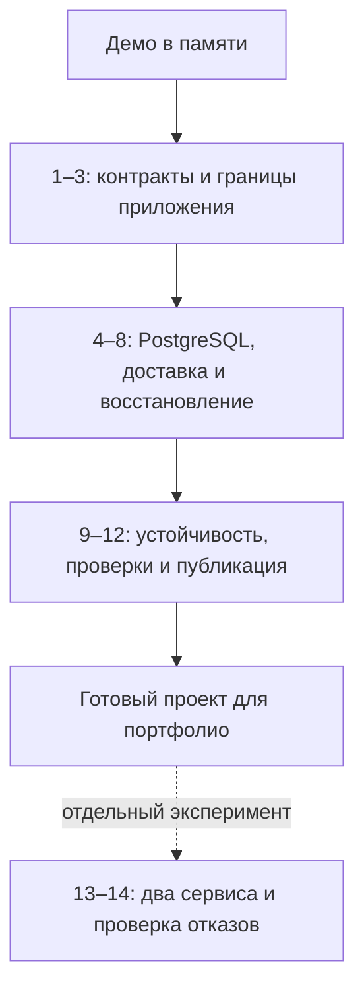
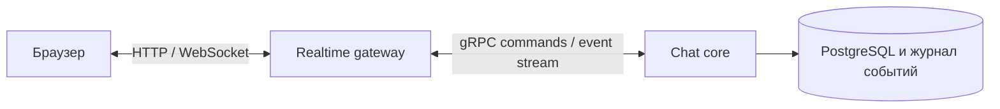

# Пошаговый план модернизации nullchat

Статус: шаг 1 выполнен документально; шаги 2–14 ещё предстоит реализовать. Обновлено 20.09.2026 после просмотра текущего кода.

Цель: превратить демо в надёжный Go-проект для портфолио, сохраняя работающий пользовательский сценарий после каждого изменения. Сначала — монолит с PostgreSQL, затем публичная демонстрация и, при желании, два сервиса.

## Отправная точка

Уже есть комнаты на двоих, одноразовые приглашения, WebSocket, история в памяти, TTL, дедупликация, интерфейс и тесты с детектором гонок. Исходный сценарий описан в [ТЗ](../SPEC.md), выполненные проверки — в [VERIFICATION.md](VERIFICATION.md).

Конкретные ограничения текущего кода:

| Где | Сейчас | Что нужно изменить |
|---|---|---|
| `internal/chat/service.go` | Правила, хранение и подписки объединены; один mutex на весь сервис | Выделить атомарные операции хранения и управление подписками |
| `Service.Close()` и `cmd/server/main.go` | Остановка процесса закрывает все комнаты | Разделить остановку приложения и завершение разговора |
| `web/app.js`, обработчик `server_shutdown` | Браузер завершает комнату и удаляет сессию | Сохранять сессию при временной недоступности сервера |
| `Create` / `Join` | Потерянный HTTP-ответ нельзя безопасно повторить | Идемпотентное создание и использование приглашения |
| `Send` | Ack после записи в RAM | Ack после успешного commit в PostgreSQL |
| `Subscribe` | Вся история копируется под общей блокировкой | История страницами и восстановление потока по курсору |
| `web/app.js`, обработчик ошибок | Неудачное сообщение удаляется из pending; текст возвращается только в пустое поле ввода | Явное состояние ошибки и повтор без потери текста |
| `httpapi.Server.admit` | Один бюджет на create, join и reconnect | Раздельные ограничения с понятным поведением клиента |
| Compose / CI | Описаны, Docker и удалённый CI ещё не проверены | Воспроизводимый запуск с БД и проверка в CI |

## Маршрут и контрольные точки



| Результат | Шаги | Условие завершения |
|---|---|---|
| Версия 0.2: надёжный монолит | 1–8 | Активные комнаты и подтверждённые сообщения переживают рестарт; ошибки сети допускают безопасный повтор |
| Версия 0.3: версия для портфолио | 9–12 | Рабочее HTTPS-демо, CI, автоматический браузерный сценарий и измерения |
| Версия 0.4: распределённый эксперимент | 13–14 | Gateway и core восстанавливаются после независимых сбоев; результат сравнен с монолитом |

Порядок выполнения — сверху вниз. Не нужно заранее добавлять Redis, брокер, Kubernetes, группы, файлы или E2EE. Они не входят в критерии готовности этого плана. Тесты добавляются в том же изменении, что и соответствующее поведение, а не откладываются на конец.

## Шаг 1. Зафиксировать поведение следующей версии

**Зачем:** отделить намеренные свойства временного чата от ограничений демо.

- [x] Обновить SPEC: TTL по-прежнему начинается при создании и не продлевается; закрытая вкладка не освобождает место; любой участник может завершить комнату.
- [x] Зафиксировать новое правило: перезапуск backend разрывает соединение, но не закрывает активную комнату и не отзывает сессию.
- [x] Определить `ack` как принятие сообщения БД, отдельно от доставки и прочтения собеседником. Указать зависимость durability от настроек PostgreSQL.
- [x] Описать состояния интерфейса: connecting, connected, reconnecting, expired, closed, unavailable; отличать временную ошибку от окончательного отзыва доступа.
- [x] Разделить ошибки лимитов: заполненная комната, лимит сообщений, лимит соединений, частые запросы, недоступная БД.
- [x] Зафиксировать лимиты версии 0.2, срок хранения данных и срок повторного получения результата create/join.
- [x] Не зависеть от фиксированных псевдонимов: backend генерирует случайное английское display name для каждого участника и не допускает повторения имени внутри комнаты.

**Файлы:** `SPEC.md`, `docs/ARCHITECTURE.md`, `internal/chat/service.go`.

**Готово, когда:** для потери сети, рестарта, поздней отправки и повторного входа можно однозначно описать результат. Изменения ТЗ помечены как целевые до реализации.

## Шаг 2. Исправить состояния отправки и переподключения в интерфейсе

**Зачем:** не терять введённый текст при ошибках, уже возможных в демо.

- [ ] Разделить сообщения на pending, accepted и failed; failed оставлять в интерфейсе с кнопкой повтора.
- [ ] Повторять сообщение с прежним `client_message_id`; изменение текста оформлять как новое сообщение с новым ID.
- [ ] Не перезаписывать новый черновик текстом неудачной отправки.
- [ ] Проверять состояние сокета перед отправкой; добавить случайный разброс задержек reconnect и ограниченную частоту повторов.
- [ ] Различать временную перегрузку, истечение TTL и неверную сессию. Исчерпание лимита соединений не должно само по себе стирать действующую сессию.
- [ ] Оставить историю вне постоянного браузерного хранилища; явно описать, что происходит с неотправленным текстом при reload.

**Файлы:** `web/app.js`, при необходимости `web/style.css` и ошибки `internal/httpapi`.

**Проверки:** ошибка отправки при непустом новом черновике; потеря ack; повтор одного сообщения; временный отказ reconnect. Текст не исчезает и не создаёт дубликаты.

**Готово, когда:** пользователь видит, что принято сервером, что не отправлено и что можно повторить.

## Шаг 3. Выделить прикладные границы без изменения поведения

**Зачем:** добавить PostgreSQL без SQL в HTTP-обработчиках и без превращения одного пакета в универсальный framework.

- [ ] Оставить типы комнат, сообщений и сценарии в `internal/chat`.
- [ ] Определить небольшие порты вокруг атомарных операций: создание комнаты с сессией, использование приглашения, добавление сообщения, завершение комнаты, чтение истории.
- [ ] Добавить `context.Context` в операции, которые будут обращаться к БД или сети.
- [ ] Перенести in-memory хранение в `internal/storage/memory`; перенести подписки и ограниченные очереди в отдельный компонент `internal/realtime`.
- [ ] Обеспечить атомарность правил внутри операции адаптера. Не реализовывать вход как независимые `GetRoom` → проверка → `SaveRoom`.
- [ ] Сохранить текущую гарантию отсутствия разрыва между snapshot и подпиской до замены её механизмом из шага 8.
- [ ] Разделить будущие операции `EndRoom` и `Shutdown`; внедрение нового поведения для постоянного хранилища завершить в шаге 7.

**Предлагаемая структура после рефакторинга:**

```text
cmd/server/
internal/chat/               модели, сценарии и используемые ими порты
internal/storage/memory/     адаптер демо и контрактные тесты
internal/storage/postgres/   появится в шаге 4
internal/realtime/           подписки, очереди и диспетчер событий
internal/httpapi/            HTTP и WebSocket
internal/config/            разбор и проверка конфигурации
migrations/
web/
```

**Проверки:** существующие интеграционные тесты; общие контрактные тесты для адаптеров хранения; `go test -race ./...`.

**Прогресс:** `chat.Application` с `context.Context` и `internal/realtime.Hub` уже выделены отдельным рабочим изменением. In-memory состояние пока остаётся в `chat.Service`; перенос в `internal/storage/memory` и контрактные тесты адаптеров ещё не выполнены.

**Готово, когда:** внешнее API демо работает как прежде, прикладные типы не зависят от SQL/HTTP, а места обеспечения атомарности явно задокументированы. Не нужно вводить интерфейс для каждой структуры.

## Шаг 4. Подготовить PostgreSQL, миграции и конфигурацию

**Зависит от:** шага 3.

- [ ] Добавить PostgreSQL в Compose с volume и проверкой готовности; образ и Go-драйвер выбрать и закрепить при реализации.
- [ ] Добавить версионируемые миграции и отдельную команду их запуска. Не запускать потенциально конфликтующие миграции автоматически из каждого экземпляра API.
- [ ] Добавить `DATABASE_URL`, адрес сервера, лимиты и таймауты; проверять конфигурацию при старте, не выводить секреты.
- [ ] Подключить пул соединений с ограничениями и timeout; освобождать его при остановке.
- [ ] Разделить liveness и readiness: процесс может быть жив, но не готов принимать операции при недоступной БД.
- [ ] Добавить тестовую БД в CI и интеграционные тесты миграций.

**Начальная схема:**

| Таблица | Основные поля и ограничения |
|---|---|
| `rooms` | ID, title, status, expires_at, closed_at, счётчики последовательностей |
| `participants` | ID, room_id, name, slot; slot только 1 или 2, UNIQUE(room_id, slot) |
| `sessions` | token_hash, participant_id, expires_at, revoked_at |
| `invites` | token_hash, room_id, consumed_at, expires_at |
| `messages` | ID, room_id, participant_id, client_message_id, sequence, text, created_at |

Индексы: `rooms(expires_at)`, `messages(room_id, sequence)`. Уникальность сообщений: `(room_id, participant_id, client_message_id)` и `(room_id, sequence)`. Внешние ключи должны исключать сообщение от участника другой комнаты. По одному ID без проверки сессии данные не выдаются.

**Готово, когда:** чистая БД разворачивается миграциями, повторный запуск не меняет применённую схему, приложение не сообщает readiness до доступности БД, интеграционные тесты проходят в CI.

## Шаг 5. Реализовать транзакционные сценарии и безопасный повтор HTTP

**Зависит от:** шага 4.

- [ ] `CreateRoom`: комната, первый участник, приглашение и сессия создаются одной транзакцией.
- [ ] `JoinRoom`: проверка срока, атомарное использование приглашения, занятие второго места и выдача сессии происходят вместе.
- [ ] `AppendMessage`: проверка доступа и срока, дедупликация, выделение sequence и запись сообщения — одна транзакция; ack только после commit.
- [ ] `EndRoom`: повторяемое завершение, отзыв сессий и приглашения, прекращение дальнейших отправок.
- [ ] Сериализовать конфликтующие изменения блокировкой строки комнаты и ограничениями БД; договориться о едином порядке блокировок.
- [ ] Проверять deadline после получения блокировки по актуальному серверному времени, чтобы ожидание блокировки не позволило позднюю запись. Зафиксировать точку проверки TTL относительно commit.
- [ ] Добавить идемпотентность create/join: тот же ключ и тот же запрос возвращают исходный результат, другой запрос с тем же ключом получает конфликт.

**Отдельно решить выдачу токенов при повторе.** Хеш сессии не позволяет восстановить исходный токен для потерянного HTTP-ответа. До реализации выбрать и записать безопасный механизм: например, криптографически случайный секрет повторения и краткоживущий зашифрованный ответ в `idempotency_requests`. Проверять отпечаток запроса и права на повтор; срок ответа не должен выходить за срок комнаты. Не возвращать действующую сессию после закрытия комнаты и не хранить открытые токены в логах. Одного публичного request ID недостаточно для выдачи credentials.

**Проверки:** одновременный join из десятков запросов; конкурентные дубликаты сообщений; send одновременно с end/TTL; потеря ответа после commit; rollback в середине операции. Для идемпотентности проверять и успешный повтор, и отказ с другим запросом/секретом.

**Готово, когда:** ограничения обеспечивает PostgreSQL, а потеря ответа не создаёт дополнительную комнату/участника и не лишает клиента уже выданной сессии в пределах согласованного окна повтора.

## Шаг 6. Устранить разрыв между записью и доставкой события

**Зачем:** успешный commit не гарантирует, что следующий вызов broadcast состоится. Одного reconnect недостаточно для клиента, который остаётся подключённым и не знает о пропуске.

- [ ] Добавить журнал событий/outbox в PostgreSQL. Изменение комнаты или сообщения и соответствующее событие записываются одной транзакцией.
- [ ] Ввести уникальный ID и последовательность событий внутри комнаты. Курсор событий и sequence сообщений — разные сущности, поскольку события включают вход и закрытие.
- [ ] Добавить диспетчер, который читает события ограниченными порциями и передаёт их подписчикам; повтор после сбоя допускается.
- [ ] Сохранять события для replay до согласованного срока, не удалять их сразу после первой публикации.
- [ ] Дедуплицировать повторную доставку по ID; обеспечить порядок событий комнаты. Признак «опубликовано» не называть подтверждением доставки в браузер.
- [ ] В первой версии поддерживать один активный core/диспетчер и явно ограничить запуск. Распределение событий между несколькими core — отдельная задача.

**Проверки:** падение после commit до публикации; падение после публикации до отметки обработки; временная недоступность БД. Сообщение появляется после восстановления, в UI остаётся одна копия.

**Готово, когда:** подтверждённое сообщение не остаётся навсегда невидимым из-за сбоя между БД и broadcast. Задержка восстановления измеряется; exactly-once транспорт не обещается.

## Шаг 7. Восстановление после рестарта и корректный TTL

**Зависит от:** шагов 5–6.

- [ ] Остановка процесса отменяет фоновые задачи и закрывает сокеты, но не вызывает бизнес-операцию завершения всех комнат.
- [ ] `server_shutdown` в браузере переводит интерфейс в reconnecting; сессия удаляется только при окончательном отказе доступа или завершении комнаты.
- [ ] После запуска читать актуальные сессии и комнаты из БД; не загружать без необходимости всю историю в RAM.
- [ ] Запускать очистку просроченных комнат при старте и затем периодически. Проверка доступа не должна зависеть от своевременности очистителя.
- [ ] Обрабатывать очистку порциями; повтор операции и сбой посередине безопасны.
- [ ] Разделить логическое закрытие и физическую очистку. Сначала прекратить доступ и сформировать событие, затем удалять данные по политике retention.
- [ ] Описать судьбу сообщений, токенов, outbox, данных идемпотентности, WAL и резервных копий. Указать максимальную задержку очистки основной БД.

**Проверки:** обычный restart и принудительное убийство процесса; TTL истекает во время простоя; сбой очистителя; конкурентная отправка во время закрытия. Сохранённый токен не открывает просроченную комнату.

**Готово, когда:** активный разговор продолжается после перезапуска без нового приглашения, подтверждённая история сохранена, просроченные комнаты не восстанавливают доступ.

## Шаг 8. История страницами и восстановление потока по курсору

**Зависит от:** шагов 6–7.

- [ ] Добавить авторизованное чтение истории с `before_sequence`/`after_sequence` и ограничением размера страницы.
- [ ] При первом подключении передавать метаданные и ограниченную последнюю страницу; старые сообщения подгружать отдельно.
- [ ] Для восстановления активной страницы передавать последний непрерывно обработанный event cursor. Максимальный увиденный номер не считать непрерывным курсором, если есть пропуск.
- [ ] Спроектировать handoff истории и live-потока: подписаться и ограниченно буферизовать события, получить согласованный снимок с watermark, дочитать журнал до него, затем перейти к live с дедупликацией.
- [ ] При переполнении буфера повторять синхронизацию; при недоступном старом курсоре возвращать явный `resync_required`.
- [ ] Не использовать сохранённый курсор как замену локальной истории: после reload без истории нужен новый начальный снимок.
- [ ] Сохранить положение прокрутки при загрузке старых сообщений; не перерисовывать весь список на каждый ack.

**Проверки:** сообщение на границе snapshot/subscribe; несколько страниц истории; обрыв между соседними событиями; устаревший cursor; повтор события; закрытие комнаты во время replay.

**Готово, когда:** большой разговор не отправляется целиком при каждом reconnect, порядок соблюдается, события на границе синхронизации не теряются.

**Контрольная точка 0.2:** обновить ТЗ и README по фактически выполненным гарантиям; повторить браузерный сценарий с рестартом backend. Публикацию пока не считать завершённой.

## Шаг 9. Устойчивость и ограничения публичного доступа

- [ ] Разделить бюджеты create, join, upgrade и отправки; при перегрузке возвращать стабильные коды и retry delay.
- [ ] Не блокировать восстановление уже действующих сессий общим бюджетом создания комнат.
- [ ] Учитывать все входящие WS-команды, включая ошибочные, а не только успешно записанные сообщения.
- [ ] Ограничить память, подключения, очереди, размер истории на запрос и время операций БД.
- [ ] Использовать явный список допустимых браузерных origin; доверять forwarded-заголовкам только от настроенного reverse proxy.
- [ ] Выбрать модель ограничения злоупотреблений без постоянного хранения IP. Если нужны краткоживущие IP-derived счётчики, описать их срок и не заявлять отсутствие обработки IP.
- [ ] Проверить отсутствие токенов, текстов и персональных данных в прикладных/proxy логах и метриках.
- [ ] Протестировать draining и закрытие сокетов при SIGTERM; фоновые задачи должны завершаться в пределах timeout.

**Готово, когда:** медленный клиент и поток некорректных запросов не создают неограниченные очереди/горутины, обычные участники восстанавливают соединение после временного сбоя.

## Шаг 10. Наблюдаемость и измерения

- [ ] Добавить метрики активных сокетов, соединений с БД, длительности запросов, commit→событие, глубины очередей, задержки outbox и TTL-очистки.
- [ ] Не использовать токены, room_id или user_id как labels; контролировать число временных рядов.
- [ ] Добавить структурированные логи системных ошибок с correlation ID без содержимого переписки.
- [ ] Открывать pprof только на отдельном административном интерфейсе.
- [ ] Подготовить воспроизводимые нагрузки: спокойные комнаты, массовая отправка, медленные клиенты, серия reconnect, длительный прогон.
- [ ] Снимать p50/p95/p99, ошибки, память, горутины, CPU и нагрузку БД; проверять возвращение числа горутин к норме после ухода клиентов.
- [ ] Зафиксировать оборудование, версии, параметры и точку насыщения в `docs/PERFORMANCE.md`; целевые лимиты выбирать по результатам, а не объявлять заранее.

**Готово, когда:** результаты можно повторить и объяснить, что первым ограничивает систему. Оптимизации выносятся в отдельные изменения с измерением до/после.

## Шаг 11. Воспроизводимые проверки в CI

Этот шаг объединяет уже добавленные тесты; он не заменяет проверки в шагах 2–10.

- [ ] Запускать unit/contract/integration тесты, race, vet и сборку на чистом окружении с PostgreSQL.
- [ ] Проверять миграции на пустой БД и обновление с предыдущей схемы.
- [ ] Автоматизировать браузерный сценарий: create → join → сообщения → reload → повтор приглашения → end/TTL.
- [ ] Добавить управляемые сбои БД/процесса и проверку commit-before-ack; не подменять их одними моками.
- [ ] Проверять сборку контейнера и readiness после `docker compose up`.
- [ ] Сохранять отчёты и скриншоты только с синтетическими данными; исключить credentials из публичных артефактов.

**Готово, когда:** pull request получает воспроизводимый результат на чистой машине, а запуск CI не зависит от локального кэша или ручной подготовки БД.

## Шаг 12. Подготовить версию для портфолио

- [ ] Подготовить HTTPS reverse proxy, окружение и инструкцию развёртывания; проверить проксирование WebSocket и политику логов.
- [ ] Запустить сервис с проверенными лимитами и readiness; предусмотреть воспроизводимый перезапуск и совместимые миграции при обновлении.
- [ ] Обновить README: цель, быстрый запуск, схема архитектуры, демонстрация, проверки, гарантии и ограничения.
- [ ] Добавить короткие ADR о PostgreSQL, дедупликации, outbox, сессиях и причинах сохранения монолита.
- [ ] Записать короткое демо, где видны два браузера, сетевой обрыв/рестарт и восстановление переписки.
- [ ] Опубликовать результаты нагрузки с условиями измерения и описанием оставшихся ограничений.

**Готово, когда:** другой разработчик запускает проект по README, а по репозиторию понятно, какие инженерные задачи решены и чем подтверждена корректность.

**Контрольная точка 0.3:** проект уже пригоден для портфолио. Два микросервиса не являются обязательным условием публикации.

## Шаг 13. Выделить два сервиса как отдельный эксперимент

**Начинать после:** версии 0.3 и ADR с целью разделения. Предлагаемая цель — независимое управление WebSocket-соединениями и изучение межсервисных сбоев.



- [ ] Gateway владеет внешним транспортом, heartbeat, очередями и транспортными лимитами; не читает БД напрямую.
- [ ] Core владеет комнатами, сессиями, TTL, сообщениями, транзакциями и журналом событий; повторно проверяет полномочия команд.
- [ ] Описать protobuf-контракты команд и server-streaming событий, ошибки, ограничения размеров и совместимость версий.
- [ ] Пробрасывать deadlines/cancellation; retries только для операций с определённой идемпотентностью и с прежними ключами.
- [ ] Аутентифицировать gateway перед core; не выставлять внутреннее API публично без защиты.
- [ ] Реализовать replay по курсору и backpressure потока; отставание одного gateway не должно блокировать остальных.
- [ ] Начать с одного core и двух gateway. События комнаты должны доходить до обоих gateway с подключёнными участниками, а не распределяться между ними как задания очереди.
- [ ] Не добавлять брокер вместе с первым выделением. Если он понадобится, отдельно определить fan-out, доставку, retention и взаимодействие с outbox.

**Готово, когда:** два участника на разных gateway общаются, остановка одного gateway не завершает комнату, а его клиенты восстанавливаются через другой с прежними сессиями.

## Шаг 14. Проверить распределённые отказы и оценить пользу разделения

- [ ] Остановить gateway во время отправки; проверить повтор без дубликата после reconnect.
- [ ] Остановить core после commit до ответа; проверить восстановление результата и событий.
- [ ] Оборвать gateway↔core при работающем browser↔gateway; UI не должен показывать ложное состояние готовности к отправке.
- [ ] Замедлить event stream, создать повторы и разрыв курсора; проверить ограниченную память и корректный replay.
- [ ] Проверить несовместимый контракт и истёкший межсервисный deadline.
- [ ] Повторить нагрузку из шага 10 на том же оборудовании; сравнить задержки, ресурсы, пределы и стоимость эксплуатации.
- [ ] Записать вывод: что улучшилось, какие новые отказы появились и стоит ли сохранять разделение.

**Готово, когда:** есть работающие failure-сценарии и сравнение с монолитом. Несколько экземпляров core требуют отдельного проекта общей доставки/владения комнатами и пока не считаются поддерживаемыми.

## Как превращать план в изменения

Один шаг — самостоятельный результат; крупные шаги 5, 6 и 8 разбивать на несколько PR, которые сохраняют работоспособность приложения. Не смешивать перенос файлов, изменение протокола и подключение БД в одном большом diff.

Первый набор изменений:

1. **PR 1:** целевые гарантии, состояния и коды ошибок — шаг 1.
2. **PR 2:** failed-сообщения и безопасный повтор в UI — шаг 2.
3. **PR 3:** прикладные порты, memory-адаптер и разделение подписок — шаг 3.
4. **PR 4:** PostgreSQL в Compose, конфигурация, миграции, readiness и тестовая БД — шаг 4.
5. **PR 5–7:** транзакционные create/join, безопасный replay credentials и запись сообщений — шаг 5.
6. **Следующие PR:** события, рестарт/TTL и cursor по шагам 6–8, затем контрольная точка 0.2.

Для каждого изменения фиксировать: проблему и новое поведение, затронутый контракт, миграции, доказательство корректности и ограничения. Чекбокс отмечать только после выполнения критерия готовности, а не после создания файлов.

Календарные оценки здесь намеренно не заданы: они зависят от доступного времени и того, какие части будут изучаться впервые. Оценивать следующий небольшой шаг после завершения предыдущего; архитектурное разделение не должно задерживать готовую версию монолита.
