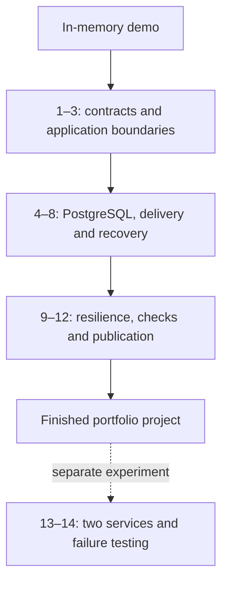
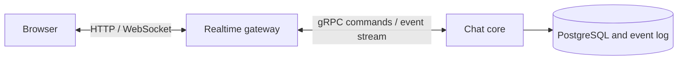

# nullchat step-by-step modernization plan

Status: the PostgreSQL foundation of 0.2 is implemented: steps 1 and 3, the local infrastructure of step 4, the transactional scenarios of step 5, and restart recovery/TTL from part of step 7. Step 2, the CI of step 4, and steps 6–14 are not complete. Outbox/replay, paging, physical cleanup and multiple services are deferred. Updated 2026-09-26; verification results are in [VERIFICATION.md](VERIFICATION.md).

Goal: turn the demo into a reliable Go portfolio project while keeping the user flow working after every change. First a monolith with PostgreSQL, then a public demo and, optionally, two services.

## Starting point

There are already two-person rooms, one-time invites, WebSocket, PostgreSQL history, TTL, deduplication, idempotent create/join and tests with the race detector. The runtime uses `internal/storage/postgres`; the memory adapter is kept for the demo/tests. The original flow is described in the [spec](../SPEC.md).

Concrete limitations of the current code:

| Where | Now | What needs to change |
|---|---|---|
| `chat.Application`, PostgreSQL adapter, hub | Boundaries extracted; SQL and transactions inside the adapter | Keep the boundaries in future changes |
| `Service.Close()` and `cmd/server/main.go` | Shutdown closes the transport/pool, rooms are kept | Physical cleanup and retention still needed |
| `web/app.js`, `server_shutdown` | Session is kept, reconnect allowed | Full failed/unavailable UI still needed |
| `Create` / `Join` | A retry with the same Idempotency-Key returns encrypted replay credentials | The encryption key must persist across restarts |
| `Send` | Ack after the PostgreSQL commit | Outbox for the commit→broadcast gap |
| `Subscribe` | Full snapshot under the room lock, local subscription with no gap | Paged history and cursor-based stream recovery |
| `web/app.js`, error handler | A failed message is removed from pending; the text is restored only into an empty input field | Explicit error state and retry without losing text |
| `httpapi.Server.admit` | One budget for create, join and reconnect | Separate limits with clear client behavior |
| Compose / CI | PostgreSQL 17, migrations, readiness and an isolated test DB are described in Compose; run results are in VERIFICATION | Remote CI not yet verified |

## Route and checkpoints



| Result | Steps | Completion condition |
|---|---|---|
| Version 0.2: reliable monolith | 1–8 | Active rooms and acknowledged messages survive a restart; network errors allow a safe retry |
| Version 0.3: portfolio version | 9–12 | Working HTTPS demo, CI, automated browser scenario and measurements |
| Version 0.4: distributed experiment | 13–14 | Gateway and core recover after independent failures; the result is compared with the monolith |

Hardening based on the review of a comparable project (logs without IPs, fixed message size, physical cleanup, panics, reproducible build, limits without storing IPs) is a separate [plan](superpowers/plans/2026-11-06-competitor-hardening.md); its stages A, C1 and F cover part of steps 9, 11 and 12.

Steps are done top to bottom. Do not add Redis, a broker, Kubernetes, groups or files ahead of time. They are not part of this plan's completion criteria. E2EE was added separately on request (decision 006 in ARCHITECTURE.md, [plan](superpowers/plans/2026-11-06-e2ee.md)); later steps (PostgreSQL, cursors, outbox) store `ciphertext`, `encrypted_title` and `key_share` as opaque data. Tests are added in the same change as the corresponding behavior, not postponed to the end.

## Step 1. Pin down the behavior of the next version

**Why:** separate the intentional properties of an ephemeral chat from the demo's limitations.

- [x] Update SPEC: TTL still starts at creation and is not extended; a closed tab does not free the seat; any participant can end the room.
- [x] Pin down the new rule: a backend restart breaks the connection but does not close an active room or revoke the session.
- [x] Define `ack` as the DB accepting the message, separate from delivery to and reading by the contact. State that durability depends on PostgreSQL settings.
- [x] Describe the UI states: connecting, connected, reconnecting, expired, closed, unavailable; distinguish a temporary error from a final revocation of access.
- [x] Split limit errors: full room, message limit, connection limit, frequent requests, unavailable DB.
- [x] Pin down the version 0.2 limits, the data retention period and the period for re-fetching the create/join result.
- [x] Do not depend on fixed pseudonyms: the backend generates a random English display name for each participant and does not allow a repeated name within a room.

**Files:** `SPEC.md`, `docs/ARCHITECTURE.md`, `internal/chat/service.go`.

**Done when:** the outcome of network loss, restart, late send and re-join can be described unambiguously. Spec changes are marked as target behavior until implemented.

## Step 2. Fix the send and reconnect states in the UI

**Why:** do not lose typed text on errors that are already possible in the demo.

- [ ] Split messages into pending, accepted and failed; keep failed ones in the UI with a retry button.
- [ ] Retry a message with the same `client_message_id`; treat edited text as a new message with a new ID.
- [ ] Do not overwrite a new draft with the text of a failed send.
- [ ] Check the socket state before sending; add random jitter to reconnect delays and a bounded retry rate.
- [ ] Distinguish temporary overload, TTL expiry and an invalid session. Hitting the connection limit must not by itself erase a valid session.
- [ ] Keep history out of persistent browser storage; describe explicitly what happens to unsent text on reload.

**Files:** `web/app.js`, if needed `web/style.css` and `internal/httpapi` errors.

**Checks:** send error with a non-empty new draft; lost ack; retry of a single message; temporary reconnect failure. Text does not disappear and does not create duplicates.

**Done when:** the user sees what the server accepted, what was not sent and what can be retried.

## Step 3. Extract application boundaries without changing behavior

**Why:** add PostgreSQL without SQL in HTTP handlers and without turning a single package into a general-purpose framework.

- [x] Keep room, message and scenario types in the transport-independent `internal/chat` layer; the adapter implementation does not import HTTP or WebSocket.
- [x] Define a small `Application` port around atomic operations: create a room with a session, use an invite, add a message, end a room, read history via a snapshot.
- [x] Add `context.Context` to operations that will access the DB or network.
- [x] Move in-memory storage into `internal/storage/memory`; move subscriptions and bounded queues into a separate `internal/realtime` component.
- [x] Ensure rules are atomic within an adapter operation. Do not implement join as independent `GetRoom` → check → `SaveRoom`.
- [x] Keep the current guarantee of no gap between snapshot and subscription until it is replaced by the mechanism from step 8.
- [x] Separate `End` from infrastructure shutdown: PostgreSQL `Service.Close` closes subscriptions, the runtime closes the transport and pool; rooms are not ended.

**Proposed structure after the refactoring:**

```text
cmd/server/
internal/chat/               models, scenarios and the ports they use
internal/storage/memory/     demo adapter and contract tests
internal/storage/postgres/   active adapter and embedded migrations/
internal/realtime/           subscriptions, queues and event dispatcher
internal/httpapi/            HTTP and WebSocket
internal/config/            configuration parsing and validation
web/
```

**Checks:** existing integration tests; shared contract tests for storage adapters; `go test -race ./...`.

**Progress:** `chat.Application`, `internal/storage/memory`, `internal/storage/postgres` and `internal/realtime.Hub` are extracted. Scenarios are checked by separate adapter tests; there is no single parameterized contract suite yet.

**Done when:** the demo's external API works as before, application types do not depend on SQL/HTTP, and the places that ensure atomicity are explicitly documented. There is no need to introduce an interface for every struct.

## Step 4. Set up PostgreSQL, migrations and configuration

**Depends on:** step 3.

- [x] Add PostgreSQL 17 (`postgres:17-alpine`) to Compose with a named volume and `pg_isready`; pgx v5.11.0, Go floor 1.25.
- [x] Add embedded versioned migrations and a separate `/migrate` command; the API does not run migrations itself.
- [x] Validate `DATABASE_URL`, `IDEMPOTENCY_ENCRYPTION_KEY`, `ADDR`, `DB_MAX_CONNS`, `DB_OPERATION_TIMEOUT`, `EXPIRY_INTERVAL` at startup without printing secrets. Room/message limits remain constants.
- [x] Connect pgxpool with limits and a timeout; release it on shutdown.
- [x] Split `/healthz` and `/readyz`: readiness checks a DB ping, not the presence of migrations.
- [x] Add a local `nullchat_test` and tests for re-applying migrations; the Compose test profile runs integration/race.
- [ ] Connect the test DB and the existing migration integration tests to CI; verify a remote run.

**Initial schema:**

| Table | Main fields and constraints |
|---|---|
| `rooms` | ID, title, status, expires_at, closed_at, sequence counters |
| `participants` | ID, room_id, name, slot; slot only 1 or 2, UNIQUE(room_id, slot) |
| `sessions` | token_hash, participant_id, expires_at, revoked_at |
| `invites` | token_hash, room_id, consumed_at, expires_at |
| `messages` | ID, room_id, participant_id, client_message_id, sequence, text, created_at |

Indexes: `rooms(expires_at)`, `messages(room_id, sequence)`. Message uniqueness: `(room_id, participant_id, client_message_id)` and `(room_id, sequence)`. Foreign keys must rule out a message from a participant of another room. No data is returned by ID alone without a session check.

**Done when:** a clean DB is set up by migrations, a repeated run does not change the applied schema, the application does not report readiness until the DB is available, and the integration tests pass in CI.

## Step 5. Implement transactional scenarios and safe HTTP retry

**Depends on:** step 4.

- [x] `Create`: the room, first participant, invite and session are created in one transaction.
- [x] `Join`: the expiry check, atomic invite use, taking the second seat and issuing the session happen together.
- [x] `Send`: the access and expiry check, deduplication, sequence allocation and message write are one transaction; ack only after commit.
- [x] `End`: closing, revoking sessions and the invite, stopping further sends. A retry with the old token gets `session_invalid`; a successful end replay is not implemented.
- [x] Serialize conflicting changes with the room lock and DB constraints; Join takes room→invite for compatibility with end/expiry.
- [x] Re-check TTL against DB time after acquiring the room lock, before the write and the commit; waiting for the lock does not allow a late send.
- [x] Create/join idempotency: the same key and request return the original result, a different request gets a conflict.

**Token issuance on retry is implemented:** an AES-GCM response envelope in `idempotency_requests`, a SHA-256 of the key and a fingerprint of the endpoint/normalized request. Replay is limited to the room's lifetime and at most 24 hours. The deployment key is stored outside the repository and does not change on restart. Plaintext tokens are not written to the DB/logs; physical deletion of old rows is not implemented yet.

**Checks:** concurrent join from dozens of requests; concurrent duplicate messages; send concurrent with end/TTL; response lost after commit; rollback in the middle of an operation. For idempotency, check both a successful retry and a rejection with a different request/secret.

**Done when:** constraints are enforced by PostgreSQL, and a lost response neither creates an extra room/participant nor deprives the client of an already issued session within the agreed retry window.

## Step 6. Close the gap between the write and event delivery

**Why:** a successful commit does not guarantee that the following broadcast call will happen. A reconnect alone is not enough for a client that stays connected and does not know it missed something.

- [ ] Add an event log/outbox in PostgreSQL. A room or message change and its corresponding event are written in one transaction.
- [ ] Introduce a unique event ID and an event sequence within a room. The event cursor and the message sequence are different things, since events include joins and closing.
- [ ] Add a dispatcher that reads events in bounded batches and passes them to subscribers; a retry after a failure is allowed.
- [ ] Keep events for replay until an agreed period, do not delete them right after the first publication.
- [ ] Deduplicate redelivery by ID; preserve the order of a room's events. Do not call the "published" flag a confirmation of delivery to the browser.
- [ ] In the first version support one active core/dispatcher and explicitly restrict startup. Distributing events across several cores is a separate task.

**Checks:** crash after commit before publication; crash after publication before marking as processed; temporary DB unavailability. The message appears after recovery, the UI keeps a single copy.

**Done when:** an acknowledged message does not stay invisible forever because of a failure between the DB and broadcast. The recovery delay is measured; exactly-once transport is not promised.

## Step 7. Recovery after restart and correct TTL

**Partially implemented, step not complete:** restart/expiry are covered by the tests below; durable events, physical deletion and retention remain deferred. SIGTERM/restart is verified; forcibly killing the process is not part of the completed acceptance.

**Depends on:** steps 5–6.

- [x] Stopping the process cancels background tasks and closes sockets, but does not call the business operation that ends all rooms.
- [x] `server_shutdown` (WS close 1001) allows reconnect; the session is kept during temporary unavailability, including code 1013.
- [x] After startup, read sessions and rooms from the DB on demand; the snapshot contains the full history of the given room.
- [x] Logically close expired rooms at startup and periodically. Access checks do not depend on the background worker.
- [x] Logical expiry processes batches, skipping busy room locks; retry and rollback are verified by tests. This is not physical cleanup.
- [ ] Separate logical closing from physical cleanup. First stop access and produce an event, then delete data according to the retention policy.
- [ ] Describe what happens to messages, tokens, outbox, idempotency data, WAL and backups. State the maximum cleanup delay for the primary DB.

**Checks:** normal restart and forced process kill; TTL expires during downtime; cleaner failure; concurrent send during closing. A saved token does not open an expired room.

**Done when:** an active conversation continues after a restart without a new invite, acknowledged history is preserved, and expired rooms do not regain access.

## Step 8. Paged history and cursor-based stream recovery

**Depends on:** steps 6–7.

- [ ] Add authorized history reads with `before_sequence`/`after_sequence` and a page size limit.
- [ ] On first connect, send metadata and a bounded last page; load older messages separately.
- [ ] To restore an active page, send the last contiguously processed event cursor. Do not treat the highest seen number as a contiguous cursor if there is a gap.
- [ ] Design the handoff between history and the live stream: subscribe and buffer events in a bounded way, get a consistent snapshot with a watermark, read the log up to it, then switch to live with deduplication.
- [ ] On buffer overflow repeat the synchronization; when the old cursor is unavailable, return an explicit `resync_required`.
- [ ] Do not use a saved cursor as a substitute for local history: after a reload without history, a new initial snapshot is needed.
- [ ] Preserve the scroll position when loading older messages; do not re-render the whole list on every ack.

**Checks:** a message on the snapshot/subscribe boundary; several history pages; a break between adjacent events; a stale cursor; event replay; room closing during replay.

**Done when:** a large conversation is not sent in full on every reconnect, order is preserved, and events on the synchronization boundary are not lost.

**Checkpoint 0.2:** update the spec and README according to the guarantees actually delivered; repeat the browser scenario with a backend restart. Do not consider publication complete yet.

## Step 9. Resilience and public access limits

- [ ] Split the create, join, upgrade and send budgets; under overload return stable codes and a retry delay.
- [ ] Do not block recovery of already valid sessions with the shared room-creation budget.
- [ ] Count all incoming WS commands, including erroneous ones, not only successfully written messages.
- [ ] Limit memory, connections, queues, history size per request and DB operation time.
- [ ] Use an explicit list of allowed browser origins; trust forwarded headers only from the configured reverse proxy.
- [ ] Choose an abuse-limiting model without persistent IP storage. If short-lived IP-derived counters are needed, describe their lifetime and do not claim that IPs are not processed.
- [ ] Verify that there are no tokens, texts or personal data in application/proxy logs and metrics.
- [ ] Test draining and socket closing on SIGTERM; background tasks must finish within the timeout.

**Done when:** a slow client and a stream of malformed requests do not create unbounded queues/goroutines, and regular participants reconnect after a temporary failure.

## Step 10. Observability and measurements

- [ ] Add metrics for active sockets, DB connections, request duration, commit→event, queue depth, outbox delay and TTL cleanup.
- [ ] Do not use tokens, room_id or user_id as labels; keep the number of time series under control.
- [ ] Add structured logs of system errors with a correlation ID and no conversation content.
- [ ] Expose pprof only on a separate administrative interface.
- [ ] Prepare reproducible loads: quiet rooms, mass sending, slow clients, a series of reconnects, a long run.
- [ ] Capture p50/p95/p99, errors, memory, goroutines, CPU and DB load; check that the goroutine count returns to normal after clients leave.
- [ ] Record the hardware, versions, parameters and saturation point in `docs/PERFORMANCE.md`; choose target limits from the results rather than announcing them in advance.

**Done when:** the results can be reproduced and it can be explained what limits the system first. Optimizations go into separate changes with before/after measurements.

## Step 11. Reproducible checks in CI

This step brings together the tests already added; it does not replace the checks in steps 2–10.

- [ ] Run unit/contract/integration tests, race, vet and the build on a clean environment with PostgreSQL.
- [ ] Check migrations on an empty DB and an upgrade from the previous schema.
- [ ] Automate the browser scenario: create → join → messages → reload → invite reuse → end/TTL.
- [ ] Add controlled DB/process failures and a commit-before-ack check; do not replace them with mocks alone.
- [ ] Check the container build and readiness after `docker compose up`.
- [ ] Keep reports and screenshots with synthetic data only; exclude credentials from public artifacts.

**Done when:** a pull request gets a reproducible result on a clean machine, and the CI run does not depend on a local cache or manual DB preparation.

## Step 12. Prepare the portfolio version

- [ ] Prepare an HTTPS reverse proxy, the environment and deployment instructions; verify WebSocket proxying and the logging policy.
- [ ] Run the service with verified limits and readiness; provide a reproducible restart and compatible migrations on upgrade.
- [ ] Update the README: goal, quick start, architecture diagram, demo, checks, guarantees and limitations.
- [ ] Add short ADRs on PostgreSQL, deduplication, outbox, sessions and the reasons for keeping the monolith.
- [ ] Record a short demo showing two browsers, a network drop/restart and conversation recovery.
- [ ] Publish the load results with the measurement conditions and a description of the remaining limitations.

**Done when:** another developer runs the project from the README, and the repository makes it clear which engineering problems were solved and what confirms correctness.

**Checkpoint 0.3:** the project is now fit for a portfolio. Two microservices are not a prerequisite for publication.

## Step 13. Extract two services as a separate experiment

**Start after:** version 0.3 and an ADR stating the goal of the split. The proposed goal is independent management of WebSocket connections and studying inter-service failures.



- [ ] The gateway owns the external transport, heartbeat, queues and transport limits; it does not read the DB directly.
- [ ] The core owns rooms, sessions, TTL, messages, transactions and the event log; it re-checks command permissions.
- [ ] Describe the protobuf contracts for commands and server-streaming events, errors, size limits and version compatibility.
- [ ] Propagate deadlines/cancellation; retries only for operations with defined idempotency and with the same keys.
- [ ] Authenticate the gateway to the core; do not expose the internal API publicly without protection.
- [ ] Implement cursor-based replay and stream backpressure; one lagging gateway must not block the others.
- [ ] Start with one core and two gateways. Room events must reach both gateways with connected participants, not be distributed between them like queue jobs.
- [ ] Do not add a broker together with the first split. If one is needed, separately define fan-out, delivery, retention and interaction with the outbox.

**Done when:** two participants on different gateways can talk, stopping one gateway does not end the room, and its clients recover through the other one with their existing sessions.

## Step 14. Test distributed failures and assess the benefit of the split

- [ ] Stop a gateway during a send; check a retry without a duplicate after reconnect.
- [ ] Stop the core after commit before the response; check recovery of the result and events.
- [ ] Break gateway↔core while browser↔gateway is working; the UI must not show a false ready-to-send state.
- [ ] Slow down the event stream, create replays and a cursor gap; check bounded memory and correct replay.
- [ ] Check an incompatible contract and an expired inter-service deadline.
- [ ] Repeat the load from step 10 on the same hardware; compare latency, resources, limits and operating cost.
- [ ] Write down the conclusion: what improved, what new failures appeared and whether the split is worth keeping.

**Done when:** there are working failure scenarios and a comparison with the monolith. Multiple core instances require a separate design for shared delivery/room ownership and are not considered supported for now.

## How to turn the plan into changes

One step is a self-contained result; split the large steps 5, 6 and 8 into several PRs that keep the application working. Do not mix moving files, protocol changes and DB integration in one big diff.

The first set of changes:

1. **PR 1:** target guarantees, states and error codes — step 1.
2. **PR 2:** failed messages and safe retry in the UI — step 2.
3. **PR 3:** application ports, memory adapter and splitting out subscriptions — step 3.
4. **PR 4:** PostgreSQL in Compose, configuration, migrations, readiness and the test DB — step 4.
5. **PR 5–7:** transactional create/join, safe replay of credentials and message writes — step 5.
6. **Following PRs:** events, restart/TTL and cursor for steps 6–8, then checkpoint 0.2.

For each change, record: the problem and the new behavior, the affected contract, migrations, proof of correctness and limitations. Tick a checkbox only after the completion criterion is met, not after the files are created.

Calendar estimates are intentionally not given here: they depend on available time and on which parts are being learned for the first time. Estimate the next small step after the previous one is finished; the architectural split must not delay the finished monolith version.
